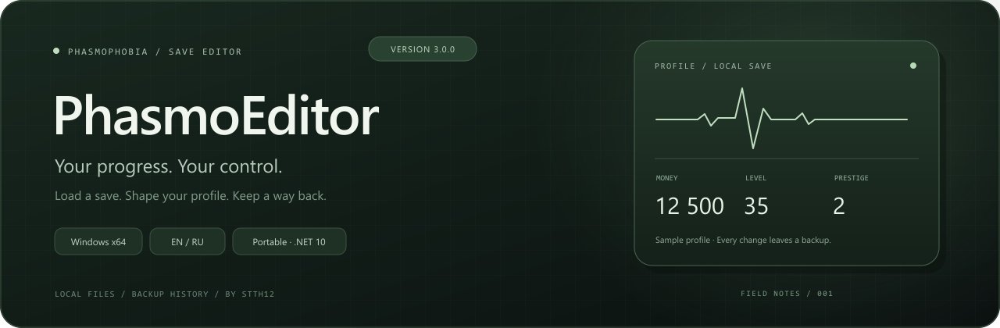
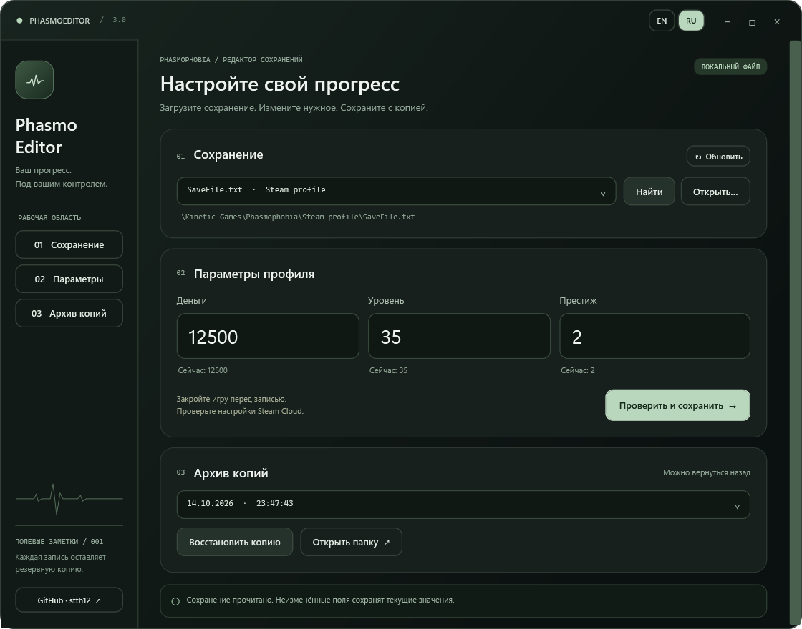

  

  Редактор сохранений <strong>Phasmophobia</strong> — деньги, уровень и престиж.

  <a href="https://github.com/stth12/PhasmoEditor/releases/download/v3.0.0/PhasmoEditor-3.0.0-win-x64.exe"><strong>Скачать для Windows x64</strong></a>
  &nbsp; · &nbsp; <a href="../README.md">English</a>
  &nbsp; · &nbsp; <a href="../CHANGELOG.md">История изменений</a>

<strong>Версия 3.0.0 · Проверено на Phasmophobia v0.19.1.0 · EN / RU</strong>

## Возможности

- Изменение денег, уровня и престижа с загрузкой текущих значений.
- Поиск сохранений во вложенных папках и выбор файла вручную.
- Просмотр изменений перед записью.
- Резервная копия при каждой записи и восстановление.
- Переключение EN / RU без перезапуска.
- Запуск одним EXE — .NET уже включён.

  

## Как пользоваться

1. Скачайте **PhasmoEditor-3.0.0-win-x64.exe** из [релиза](https://github.com/stth12/PhasmoEditor/releases/tag/v3.0.0).
2. Закройте Phasmophobia и проверьте настройки Steam Cloud.
3. Запустите EXE и нажмите **«Найти»** или **«Открыть…»**.
4. Выберите сохранение, измените значения и нажмите **«Проверить и сохранить»**.

Установка программы и отдельная установка .NET не нужны.

## Резервные копии

В разделе **«Архив копий»** выберите копию и нажмите **«Восстановить копию»**.
Копии хранятся в **PhasmoEditorBackups** рядом с выбранным файлом.
Восстановление также сохраняет текущий файл. Старые **SaveFileBackup.txt** поддерживаются.

Язык меняется кнопками **EN / RU** в верхней панели и сохраняется между запусками.

## Сборка

Нужны Windows и .NET SDK 10.

~~~powershell
./scripts/prepare-release.ps1
~~~

Готовый EXE и контрольная сумма появятся в `artifacts/release`.

---

**[stth12](https://github.com/stth12)** ·
[Сообщить об ошибке](https://github.com/stth12/PhasmoEditor/issues) ·
[Все релизы](https://github.com/stth12/PhasmoEditor/releases)
