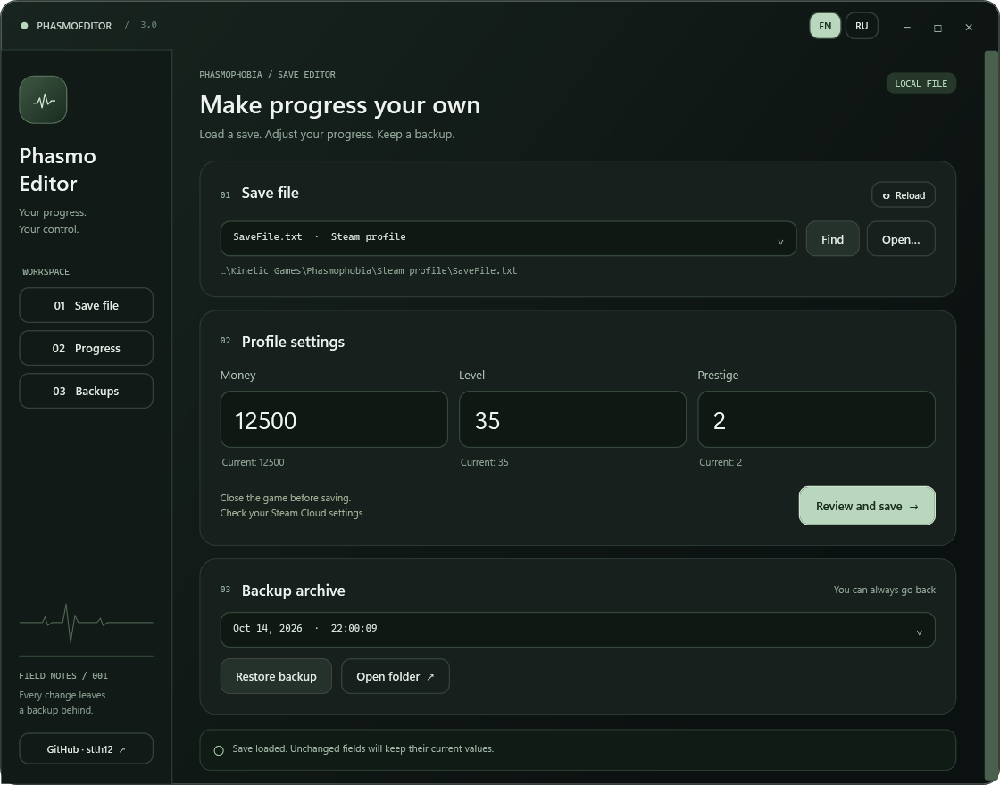

  

# PhasmoEditor 3.0 · Preview 1

**A new workspace for your Phasmophobia save.**

A major update with a redesigned interface, English / Russian support and
more reliable editing and recovery.

> **Preview status:** compatibility with the current game version is not yet verified.
> This build is checked against synthetic saves based on the previous editor's format.

## What's new

| Interface | Editing | Recovery |
| :--- | :--- | :--- |
| Rounded panels and a dark green palette | Discover nested profiles or open any save manually | Separate backups for every write |
| Instant EN / RU; English by default | Load current values and review changes | Restore valid copies, including legacy backups |
| Saved language preference and an author GitHub link | Verify the document and reject stale files | Restore a damaged file from a valid backup |

  

*Actual interface with synthetic demonstration data.*

## Get started

1. Download **PhasmoEditor-3.0.0-preview.1-win-x64.zip** from the assets below.
2. Extract it and run **PhasmoEditor.exe**. No separate .NET runtime is needed.
3. Close Phasmophobia and check Steam Cloud settings.
4. Select a save, adjust the values, then click **Review and save**.

**Backups:** `PhasmoEditorBackups` beside the selected file.
Restoring also preserves the current file.

<strong>Checks and technical changes</strong>

- Migrated from .NET Framework 4.8 to .NET 10 WPF.
- Replaced delete-and-move writes with File.Replace and backup creation.
- Removed decrypted temporary files and global replacements in JSON strings.
- Preserved unknown JSON fields by value.
- Kept the custom icon on the executable only.
- Verification covers legacy decoding, JSON preservation, backup history, restore,
  damaged saves, changed files, file locks and EN / RU preferences.
- The package includes a SHA-256 checksum.

Game-specific progression limits and the current save format still require testing.
This release does not manage Steam Cloud.

## Русский

**Новый интерфейс, EN / RU и более надёжная работа с сохранениями.**

- Английский при первом запуске, мгновенное переключение языка.
- Поиск сохранений во вложенных папках и ручной выбор.
- Текущие значения и проверка изменений перед записью.
- Отдельные резервные копии и восстановление.
- Переносимая сборка Windows x64 со встроенным .NET.
- Иконка только у EXE; ссылка на GitHub автора в приложении.

> **Предварительная версия:** совместимость с текущей игрой ещё не проверена.
> Использованы искусственные файлы прежнего формата.

<strong>Посмотреть русский интерфейс</strong>

  

Скачайте ZIP, распакуйте и запустите **PhasmoEditor.exe**.
Перед записью закройте игру и проверьте Steam Cloud.
Копии находятся в **PhasmoEditorBackups** рядом с сохранением.

---

Created by **[stth12](https://github.com/stth12)** ·
[Source code](https://github.com/stth12/PhasmoEditor) ·
[Report a problem](https://github.com/stth12/PhasmoEditor/issues)
